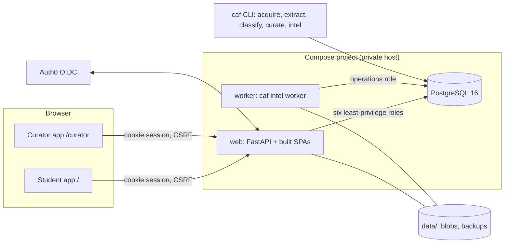
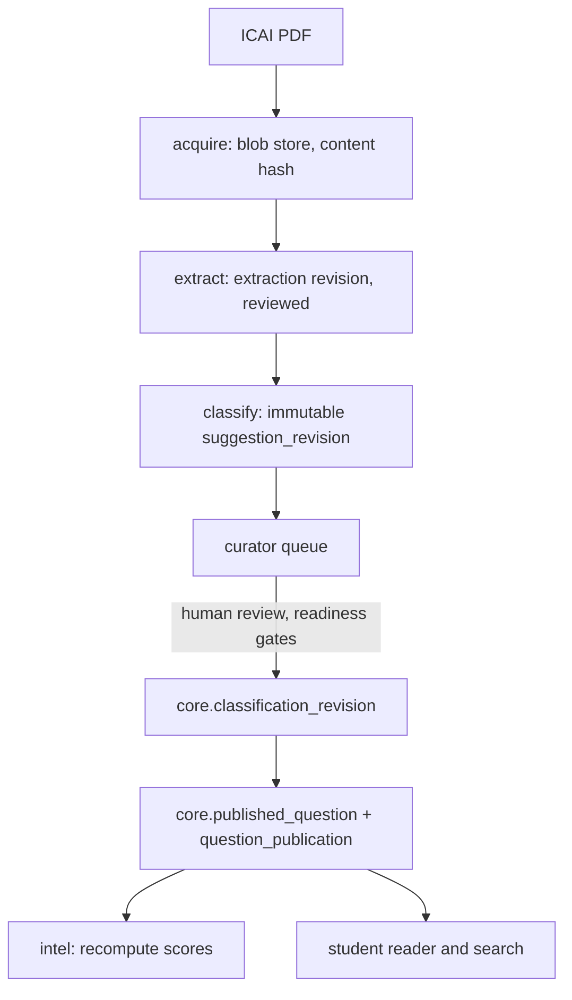

# Architecture overview

This describes the code as it is. It was written from the source on 1 November 2026; where something
could not be confirmed it says so. For deployment state read [Home_hosting.md](Home_hosting.md). For
planned changes read [../PLAN.md](../PLAN.md).

## 1. Shape of the system

- One FastAPI process (`caf_api.main:app`, a single uvicorn worker) serves `/api/v1/*`, `/auth/*` and both
  single-page apps. Static assets are the committed `web/apps/*/dist`.
- One worker process runs the score-recompute queue (`caf_l5.worker`) and writes a heartbeat file.
- Content is produced offline by the `caf` CLI; the API only reads and reviews it. The CLI needs no web server.
- External access is Tailscale HTTPS to a loopback port. PostgreSQL is not published.

## 2. Python packages and layers

Dependencies point downward only.

| Layer | Package | Responsibility |
|---|---|---|
| contracts | `caf_contracts` | Pydantic models shared by API, pipeline and tests |
| common | `caf_common` | Settings, logging, run context, backup/recovery, alarms, retention |
| db | `caf_db` | SQLAlchemy models, Alembic migrations, engines, grants |
| L0 | `caf_l0` | Taxonomy releases, descriptors, hierarchy, applicability |
| L1 | `caf_l1` | Discovery and acquisition of official PDFs; blob store |
| L2 | `caf_l2` | Text/OCR extraction and question segmentation, extraction revisions |
| L3 | `caf_l3` | Classification: lexical, Gemini, OpenRouter, batch export/import, evaluation |
| L4 | `caf_l4` | Curation: reviewed classification revisions, publication, verification, disputes |
| L5 | `caf_l5` | Scoring, planning, spaced revision, intelligence jobs and worker |
| api | `caf_api` | HTTP layer (see section 3) |
| cli | `caf_cli` | `caf` commands and `caf-host` host tooling |

## 3. Request to role to schema

The API never uses a superuser. Each request picks a database role by dependency, and the role's
grants in `caf_db/grants.py` decide what it may touch.

| Router (module) | Role | Reads | Writes |
|---|---|---|---|
| study, profile, questions, published pages | `caf_app` | `ref`, `core`, `intel` | personal `app` tables only (progress, notes, mock tests, settings, sessions) |
| auth, admin accounts and invitations | `caf_identity` | `app` identity tables | `user_account`, `invitation`, `login_transaction`, `auth_session`, `settings` |
| curate (classification review, publication) | `caf_curator` | `ref`, `core`, `intel`, `ingest` | decisions, classification revisions and events, published questions, verifications, disputes |
| extraction, taxonomy, readiness, system | `caf_operations` | all but `app` personal data | shared corpus, scoring, `ops` |
| `caf` pipeline commands | `caf_pipeline` | `ref` | `ingest`, `ops` |
| backups and `/ready` | `caf_backup` | everything (read-only) | nothing |

Authentication happens in `require_account` / `require_admin` (`caf_api/auth.py`). Sessions are opaque
tokens stored hashed in `app.auth_session`; mutating requests need a matching `Origin` and `X-CSRF-Token`.
Cross-cutting middleware in `caf_api/main.py`: request id, rate limits, security headers.

## 4. Data model (schemas)

| Schema | Holds |
|---|---|
| `ref` | Papers, attempts, taxonomy nodes and releases, descriptors, candidate catalogs |
| `ingest` | Documents, units, extraction revisions and blocks, suggestion revisions (immutable) |
| `core` | Decisions, appearances, classification revisions/events/verifications/disputes, published questions and sources, question publication pointers, baseline adoption |
| `intel` | Score runs and subtopic scores, corpus coverage, recompute jobs, attempt-to-taxonomy bindings |
| `app` | Accounts, invitations, sessions; each student's settings, progress, notes, revision events, mock tests |
| `ops` | Runs, LLM call log, Alembic version |

Migrations are forward-only (`0001` to `0010`); a downgrade raises. Never rewrite history rows:
suggestions, classification revisions and published snapshots are append-only.

## 5. From PDF to a published question

Publication needs a named reviewer. Model confidence is advisory and never publishes anything
(`caf_l4/revisions.py`, `caf_l3/evaluate.py`). Other students can verify a published revision or open a dispute
(`caf_l4/revisions.py`). Source PDFs are read only from the approved, hash-checked
blob path. The baseline adoption (`baseline-2026-10-16`) is frozen and must not be re-derived.

## 6. Frontends

`web/` is a pnpm/turbo workspace. `apps/student` and `apps/curator` are Vite + React + TanStack Query
SPAs. `packages/api-client` is generated from `openapi.json` (`pnpm --filter @caf/api-client generate`);
CI fails if the schema or generated client drift. `packages/workspace` holds the shared dialog, theme and
tokens. The apps keep a cache keyed by account and study-context generation, so switching account never
shows another account's data.

## 7. Operations

- **Config**: `config/*.toml`, `deploy/settings.toml` (production), environment variables for secrets.
  Production requires explicit OIDC settings and `MIGRATION_DATABASE_URL` for the admin profile only.
- **Backups**: `caf-host backup` takes a verified snapshot with retention (7 daily, 4 weekly, 6 monthly) and
  can encrypt to a public recipient. A database restore of a snapshot is exercised by the installer's
  restore step but is not reported as verified by the scheduled job (`restore_verified` stays false).
- **Upgrade**: `caf-host upgrade BUNDLE` snapshots first, migrates only forward and keeps the previous release.
- **Monitoring**: JSON logs, `/api/v1/ready`, authenticated `/system/health` alarms, and the `caf-host watch`
  timer with de-duplicated webhook alerts.

## 8. Known limits

- Single API worker: the rate limiter and caches are per process.
- The dashboard still issues about 34 queries per request (no longer growing with the number of papers).
- The host upgrade, backup and watch shell scripts are tested through their Python logic, not yet end to end on Docker.
- Several large curator pages and `caf_api/study.py` are long; see [../REVIEW.md](../REVIEW.md).
