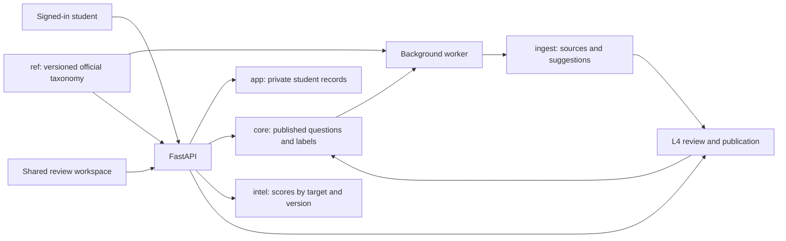

# CA Final Study Companion — Implementation Plan

Date: 1 October 2026  
Status: Approved phased direction; Phase 0 establishes the recovery and verification gate  
Repository baseline: `153c518` on `main`

## 1. Purpose and agreed product direction

The application is a study companion. It helps students navigate the syllabus, find previous exam and practice questions with their answers, understand historical topic importance, and manage their own preparation. Official study material and students’ chosen teaching resources remain the learning foundation.

The next version will provide one centrally maintained knowledge base with individual student profiles.

Decisions confirmed during this review:

| Area | Agreed direction |
|---|---|
| Access | Invited students, each with individual sign-in |
| Personal information | Progress, notes, revision history, mock results, preferences, and study plans belong to the signed-in student |
| Curation | Every invited student can contribute to the shared curation workflow |
| Publication | One student’s review is sufficient to publish a classification |
| Additional verification | Count distinct students reviewing a specific content/classification revision and explicit scope; repeat reviews do not inflate counts |
| Default target | May 2027, with an attempt setting for each profile |
| Question presentation | Show the complete main question, including its common stem and ordered parts, followed by its complete available answer |
| Classification detail | Individual parts can carry separate topic/subtopic labels; the student still sees the complete question |
| Taxonomy | Reflect the official module and chapter structure, followed by meaningful topics and subtopics |
| Paper-specific structure | Preserve official module/unit exceptions, including IBS, rather than inventing a universal hierarchy |
| Score selection | Match the student's target attempt and taxonomy/applicability/scoring/publication version context |
| Design | A restrained, attractive study workspace with clear reading and navigation flows |

No further product clarification is required to begin the phases below. Hosting and identity-provider selection are implementation decisions to make against the existing environment and cost constraints before deployment.

## 2. Review scope and evidence limits

The review covered the repository’s authored application code, configuration, taxonomy data, extraction profiles, scripts, tests, package manifests, documentation, and the complete available Git history. Parallel read-only investigations covered the web/API implementation, the processing pipeline, and the detailed guide, CLI, operational code, and tests. Findings were checked against relevant implementations and representative database aggregates.

The local PostgreSQL inspection used an enforced read-only transaction. The application was not running on port 8000 during the UI investigation. The `/plan` fixture failure was reproduced using a read-only Node execution; a complete browser session against the running application was not performed. The reported Windows/macOS difference therefore remains a reproduction task, not an established operating-system defect.

The existing test suite was not run against the working database because several tests commit changes to the configured database. Prior build-log claims that all tests passed do not establish that the current user journeys work or that the corpus is complete.

Generated bundles, dependency lockfiles, and stored documents were treated as build/data artifacts rather than evidence that the corresponding features were complete. A document-by-document comparison against every source PDF is a deliverable of the implementation, not a completed result of this review.

## 3. How the repository reached its current shape

The project has a useful separation of responsibilities:

```text
L0 Reference/taxonomy
  → L1 Discovery/acquisition
  → L2 Extraction
  → L3 Classification suggestions
  → L4 Human review/publication
  → L5 Intelligence
  → L6 API and student/curator applications
```

The six PostgreSQL schemas support that separation: `ref`, `ingest`, `core`, `intel`, `app`, and `ops`. The FastAPI backend, React/Vite applications, SQLAlchemy models, uv workspace, and pnpm workspace can support the requested product without a framework rewrite.

The design history explains several current limitations:

1. `CA_Final_Study_Tool_System_Design.md` originally described several students and inline question/answer access.
2. `CA_Final_Technical_Implementation_Plan_v2.md` explicitly superseded that design. D1 selected a local single-user application without authentication. D2 prohibited full question/answer text in student API responses.
3. Commits from 24–26 September added the layered pipeline, scoring, planning, and operational tooling.
4. Commits from 27 September added the two applications and portable launchers, with checked-in production bundles.
5. The latest commits added Gemini integration, calibration tooling, and a separate annotation script.

Important history references:

| Commit | Relevance |
|---|---|
| `8191f3a` | Introduced the authored syllabus seed and tracker API |
| `40d4581` | Added classification, curation, and atomic publication |
| `fa471bc` | Added intelligence scores and explainability |
| `eea0ea4` | Added planning, revision, and practice-related processing |
| `7c3fef3` | Added contract tests, including prohibition of student source text |
| `df4ac20` / `ecef8a1` | Added student navigation, inspector, and study features |
| `6b5efc4` | Added cross-platform launchers and prebuilt bundles |
| `f7c58cc` / `153c518` | Added the latest classification paths and benchmark tooling |

The new requirements intentionally replace D1 and D2. They preserve the useful distinction between unreviewed suggestions and published knowledge. Documentation and contract tests must change alongside implementation.

## 4. Findings that determine the implementation order

### 4.1 Student application

| Reported issue | Finding | Required change |
|---|---|---|
| Cannot open question and answer from appearances | The student API exposes appearance metadata, and the UI implements the old D2 restriction. There is no complete student question-reading contract. | Add published question/answer retrieval and a reader reached from every appearance. |
| `/plan` does not open | `Plan.tsx` constructs its demo fallback using `d.items.map`, while `fixtures/plan.json` contains `subtopics`. This runs before the API response and throws on initial render. | Correct the fixture contract, isolate demo mode, and add a route error boundary and browser regression test. |
| 750% exam score and 147% prior | `SubtopicDetail.tsx` multiplies raw `exam_score`, `practice_score`, and `weight_prior` by 100. These are decayed marks/prior marks, not normalized proportions. | Display raw units correctly and use explicit normalized fields for contribution bars. |
| Formula disagrees with implementation | The inspector presents 0.50/0.30/0.20 while configured scoring uses 0.60/0.20/0.20. | Return the formula and weights from the score snapshot; remove duplicated UI constants. |
| Filters/sorts appear ineffective | Several views substitute fixture/default values for live fields. For example, paper importance sorting uses a fallback of 0.72 when the field is absent. | Define supported fields, filters, and sorts in API contracts and test them against real response shapes. |
| Topic names absent in some views | Dashboard planning items contain `node_name`, while the UI reads `title` or `subtopic_name`. | Establish one response shape and render it without guessed alternate names. |
| Progress appears despite no completion | `Progress.tsx` uses `completedSub || 20`, replacing a valid zero with sample data. | Preserve zero, distinguish unavailable values, and remove live/demo blending. |

Relevant files:

- `web/apps/student/src/pages/Plan.tsx`
- `web/apps/student/src/pages/Dashboard.tsx`
- `web/apps/student/src/pages/Papers.tsx`
- `web/apps/student/src/pages/PaperDetail.tsx`
- `web/apps/student/src/pages/Progress.tsx`
- `web/apps/student/src/components/SubtopicDetail.tsx`
- `web/apps/student/src/fixtures/`
- `web/packages/api-client/src/`
- `packages/api/caf_api/routes.py`
- `packages/l5_intel/caf_l5/why.py`

The platform difference should be investigated by comparing source/build versions, API payloads, selected profile/attempt, local corpus state, and browser errors. It should not be attributed to macOS without reproduction.

### 4.2 Curator application and question completeness

The curator API returns the stored `UnitAnswer.answer_text`. The UI places it in a short scrollable region rather than explicitly truncating the string. Incomplete answers can therefore arise from extraction/pairing, while the constrained reader makes long answers difficult to inspect.

The extraction model already includes parent-child units, but text is attached to individual units. Reconstructing a complete question requires its root, shared stem, ordered descendants, and corresponding answer spans. Merely increasing the height of the answer panel will not repair incomplete extraction.

Additional gaps:

- Classification recommendations need a full hierarchy path, not just a subtopic name or identifier.
- The student app needs a dedicated syllabus explorer as well as the existing paper detail view.
- `core.decision` has no reviewer identity, so reliable distinct-student verification cannot be calculated.
- The current publication flow assumes one curator; it needs revision checks for concurrent edits and repeat requests.

Relevant files: `packages/l2_extract/caf_l2/{segmenter,pairing,pipeline}.py`, `packages/db/caf_db/models/{ingest,core}.py`, `packages/l4_curate/caf_l4/publish.py`, `packages/api/caf_api/curate.py`, and `web/apps/curator/src/{pages/Queue,components/NodePickerModal}.tsx`.

### 4.3 Taxonomy and weightage are not yet an audited syllabus

The repository contains 39 chapters, 77 topics, and 264 subtopics:

| Paper | Chapters | Topics | Subtopics |
|---|---:|---:|---:|
| P1 | 8 | 17 | 62 |
| P2 | 7 | 13 | 41 |
| P3 | 8 | 15 | 54 |
| P4 | 5 | 10 | 37 |
| P5 | 6 | 12 | 40 |
| P6 | 5 | 10 | 30 |

These counts describe the seed; they do not prove completeness.

- `packages/l0_taxonomy/caf_l0/seeds.py` manually defines the hierarchy.
- The YAML trees inspected contain no node-level study-material source references.
- The 27 descriptors are chapter descriptors for P1, P3, P4, and P5. There are no approved descriptors for every subtopic, despite that requirement in the technical plan.
- `generate_all_weightages` creates ranges from the number of seeded chapters. The checked-in weightages reflect those generated groupings, not a demonstrated mapping to official section-wise weightage publications.
- The node constraint permits only `chapter`, `topic`, and `subtopic`; chapters must have no parent. Modules require a deliberate schema and traversal change.
- The loader does not implement the full documented move/split/merge/deprecation workflow. Existing-node updates do not constitute a safe taxonomy migration system.

For comparison, the official Financial Reporting page lists five modules and seventeen chapters. The seed has eight differently grouped chapters and omits the official module structure. This supports the need for a source audit, rather than treating the current count as canonical. [Official Financial Reporting structure](https://www.icai.org/post/sm-final-p1-may2026).

### 4.4 Discovery, extraction, and classification

Material gaps found in the processing paths:

- Browser-mode acquisition is not a completed discovery implementation.
- Four extraction profiles exist: suggested answers, RTP, MTP answers, and case scenarios. Coverage of all declared document types is not implemented.
- The cross-document answer-pairing helper exists but is not integrated into the extraction orchestration.
- Part/subpart recognition can reset the segmenter to question mode while processing answers; this needs source-grounded regression fixtures.
- Publication coverage is currently represented by the presence of an appearance, not a complete accounting of a paper/attempt’s expected questions.
- The latest `scripts/annotate_batch.py` applies mostly P1 rules, hardcodes P1 anchor context, and falls back to an Ind AS 115 node when no match is found. It records fixed confidence values and marks these rule-based suggestions as `method="llm"`.

The annotation script is not evidence of calibrated semantic classification across all six papers. Suggestions produced by it must be identified by provenance and audited. Existing human decisions must be preserved and flagged for review where necessary, rather than silently deleted or overwritten.

### 4.5 Central deployment requires more than a profile selector

- Personal endpoints use the configured `settings.app.user_id`, ordinarily 1.
- User accounts have no authentication identity or invitation lifecycle.
- The curator frontend sends a token, but the API does not enforce the documented curator authentication boundary.
- `get_db_session` uses a common configured engine; defined database roles alone do not establish separate serving permissions.
- Scores have one globally current run. Computation can take the first settings row, and replacing the current run is not scoped to a target attempt.
- Operational and backup routes need explicit administrative authorization.

Separate profiles must work at the API, database query, cache, score-selection, and background-job boundaries.

### 4.6 Local database evidence and data hygiene

The read-only aggregate inspection found:

- One user account.
- One current score run, targeting May 2026.
- Extracted units only associated with P1 in the queried database.
- 25 published appearances, all associated with P1: 20 exam and 5 practice.
- Failed RTP records across P1–P6.
- 27 descriptors, all at chapter level.

These are local database observations, not a count of validated official questions. The build log records an earlier cleanup of automated/mock decisions, and existing tests insert synthetic records into the configured database. Corpus metrics must distinguish test data, authentic sources, reviewed content, and pending processing before any completeness claim is made.

### 4.7 Verification and operations

- The UI tests mainly verify HTML delivery, not execution of React routes. They did not detect the `/plan` render failure.
- Several tests mutate the configured database without a dedicated isolated database lifecycle.
- The initial Alembic migration imports current ORM metadata and calls `create_all`; future upgrades need explicit, reproducible migrations.
- Run status handling can report success despite individual failures. Extraction alarm stage names do not match the CLI’s emitted stage name.
- Backup verification needs stronger checks around restore success, missing tables, and personal notes/study sessions.

These gaps must be addressed before inviting multiple students into a shared deployment.

## 5. May 2027 target and source baseline

Keep three concepts separate:

1. **Student target attempt:** May 2027 by default.
2. **Applicable material edition:** selected per paper using official applicability evidence.
3. **Historical corpus coverage:** the actual exam/practice attempts and documents available, extracted, and reviewed.

Official pages checked during the review establish that:

- P4 has a page explicitly for May and November 2027. The page inspected lists Module 1 and part of Module 2, through Chapter 10. That is evidence of publication, but not evidence that the complete P4 set is available. [P4 2027 material](https://www.icai.org/post/sm-final-p4-may-nov2027).
- P5 has a separate page for May and November 2027. Its complete document inventory still needs verification. [P5 2027 material](https://www.icai.org/post/sm-final-p5-may-nov-2027).
- ICAI has published an announcement on the Income-tax Act, 2025 applying from May 2027 CA examinations. This makes attempt-specific tax applicability and historical-answer handling essential. [ICAI announcement](https://icai.org/post/23566).
- P1’s accessible edition page is labeled applicable from May 2026 onwards. A paper need not have a newly named 2027 edition to remain applicable, but that applicability must be recorded from official evidence. [P1 material](https://www.icai.org/post/sm-final-p1-may2026).

The review did not establish one latest complete all-paper/all-document attempt baseline. Phase 3 must determine that using an explicit completeness matrix. November 2026 is a candidate for comparison, not an already certified complete baseline. It is also a future exam at the date of this plan, so its future exam questions and suggested answers cannot be treated as existing historical coverage.

For May 2027 material still pending, show the verified available edition and a clear pending-update status. Do not silently relabel an older tax edition as May 2027 compliant. Do not invent exam dates or future documents. Verify the attempt registry against current official notices rather than retaining the old cadence assumptions in repository documentation.

## 6. Target architecture and data ownership

Retain the current stack and layer boundaries. Deploy the two built applications and FastAPI behind one HTTPS origin, backed by PostgreSQL and durable source storage. Run acquisition, extraction, classification, and score recomputation in a separate worker process using the existing Python packages.



| Data | Ownership and access |
|---|---|
| Official taxonomy and document catalogue | Shared; centrally maintained |
| Extracted content and machine suggestions | Shared review workspace; not automatically trusted |
| Published questions, answers, labels, and review counts | Shared across invited students |
| Progress, notes, revision outcomes, mock tests, study settings | Private to the authenticated student |
| Invitations, deployment settings, backups, destructive administration | Administrator only |

A single shared corpus does not require separate organizational tenants for this release. Preserve the ability to add organizations later without building organization billing or group-management machinery now.

## 7. Implementation phases

### Phase 0 — Safe verification, recoverable data, and revised contracts

**Purpose:** Create a reliable baseline before changing content or sharing the application.

Changes:

1. Before test-module imports, start a dedicated disposable PostgreSQL 16 container with a dynamic localhost port and temporary storage. Set database credentials and blob/debug/log/backup directories, disable external models/acquisition, apply migrations/grants, and seed deterministic reference fixtures. Clone that template for each database-changing test; reset/dispose cached settings, engines, and session factories on switches. Administrative, application, and restore connections must reject destinations outside the harness-owned container/database allowlist. Missing roles fail setup; permission tests require the actual permission-denied error. Replace local-content/order dependencies with explicit fixtures.
2. Extend the existing backup entry points. Include every `app`/`core` table, especially notes and study sessions; capture revision, counts, deterministic content digests, and `pg_dump` from one exported database snapshot. Store dump and source/config/taxonomy/profile/override file checksums in a manifest, excluding secrets. Independently restore in a separate disposable container and fail on unreadable/corrupt dumps, restore errors, absent tables, content differences, or missing/changed archived files. Verify against the manifest even when the source changes later. Reject existing/unsafe scratch destinations; preserve them. Label legacy dumps without claiming content verification. Create a unique real checkpoint without rotation/deletion.
3. Freeze `0001_initial_schema` with explicit operations preserving its revision ID and resulting schema. Introduce no placeholder migration or live schema change. Compare fresh schema and isolated recovery-checkpoint restore, including tables/constraints/indexes/foreign keys, and report drift. All subsequent schema changes require explicit forward migrations.
4. Add `uv run caf audit baseline` using enforced read-only transactions and ignored timestamped JSON/Markdown reports. Audit processing coverage, source existence/checksums/lineage, methods/models/runs/confidence, `agent-semantic-v1`, provenance-identifiable forced defaults, unexpected cross-paper mappings, questionable published links, answer pairing, personal counts, taxonomy/descriptor coverage, score context, and schema revision. Classify provenance as confirmed synthetic, suspected synthetic, authentic source identified, or unresolved, with evidence. A “test” filename alone is insufficient. Legacy decisions lack reliable reviewer identity; do not assign one. Remediation remains a later reviewed action.
5. Align D1–D3 and C0/C2/C4/C5/C6 across the technical plan, detailed guide, README, and verification instructions. Add separately versioned models in `caf_contracts.future_v1` for official hierarchy/path/version/source context, complete-question structures, revision-bound reviews, score context/units/normalization/weights/freshness, and explicit authenticated ownership/published-content boundaries. Keep current runtime models, endpoints, and ORM constraints unchanged. Retain metadata-only endpoint compatibility tests, removing universal future-content prohibitions. Pure model tests prove complete published content is representable; actual authentication, ownership enforcement, and reader endpoint tests remain Phases 2 and 6.

Files: `docs/CA_Final_Technical_Implementation_Plan_v2.md`, `docs/CA_Final_Detailed_Implementation_Guide.md`, `packages/contracts/caf_contracts/future_v1.py`, `packages/db/caf_db/alembic/`, backup/audit CLI and operations packages, test bootstrap/fixtures, settings/connection lifecycle, `README.md`, and `VERIFY.md`.

Acceptance:

- Running tests cannot modify the student’s normal database.
- Existing personal records and human decisions have a verified recovery path.
- Documentation states the new product decisions unambiguously.
- The baseline report distinguishes authentic corpus coverage from test/placeholder records.
- Normal application database URLs are rejected; individual tests are independent and the isolated suite passes.
- Synthetic backup failure handling passes before touching recovery artifacts from real data. Progress, notes, study sessions, decisions, and appearances survive restore; corrupt dumps, missing tables, restore errors, and archive tampering fail explicitly. Existing scratch databases survive.
- Fresh-install and recovered-baseline schema comparisons agree; reported drift must be resolved before later schema migrations.
- Current endpoint behavior remains compatible. No authentication/publication-reader implementation is marked complete by draft contract tests.

Execute the completion gate in this order: establish the harness; verify synthetic backup
failure/success scenarios; freeze/check migration baseline; run the read-only audit;
create and independently verify the real checkpoint; run the full isolated suite and
review the complete diff. Phase 1 starts only after all these checks pass. Preserve
existing personal data, appearances, notes, and human decisions unchanged throughout.

### Phase 1 — Repair current UI behavior and API contracts

Phase 0 acceptance passed on 2026-10-01; see
[verification evidence](Phase0_Verification.md). This enables Phase 1 but does not
mark its implementation or any later authentication/reader work complete.

Phase 1 acceptance subsequently passed on 2026-10-01; see
[Phase 1 verification](Phase1_Verification.md) for the 116 isolated Python tests,
66 Chromium/WebKit checks, generated contracts, migration, and preservation evidence.
Native Windows verification remains pending. Later phases remain unimplemented.

**Purpose:** Make the existing application honest and usable while structural work proceeds.

Changes:

1. Repair the `/plan` initial render and fixture mismatch.
2. Make demo mode explicit. Live loading, empty, zero, and error states must never fall back to sample progress, names, importance, streaks, or plans.
3. Define Pydantic response models for dashboard, paper summary/tree, plan, revision, subtopic detail, explanations, and curator queue responses.
4. Regenerate OpenAPI and the TypeScript client together. Replace guessed field mappings and unchecked casts on these paths.
5. Correct the score panel using the existing normalized explanation data; fetch weights from the backend snapshot.
6. Implement and verify each exposed filter/sort, including combined filters, empty results, and deterministic ordering. Persist useful navigation state in URL parameters.
7. Add route-level error boundaries, retry controls, and useful save/mutation error feedback.
8. Include app build/API version information in diagnostics to investigate platform differences.

Files: `packages/api/caf_api/routes.py`, `packages/l5_intel/caf_l5/{service,why,planning}.py`, `web/packages/api-client/`, `openapi.json`, and affected student/curator pages.

Acceptance:

- `/plan` loads directly and through navigation with populated, empty, slow, and failed API responses.
- Zero completion remains zero.
- Every plan item shows a real topic name and correct destination.
- Raw values such as 7.5 marks are never labeled 750%.
- Filters change the intended result set, and browser back/forward preserves selection.
- Browser tests execute the rendered pages rather than checking only HTTP status.

### Phase 2 — Add identity, private profiles, and authorization

**Purpose:** Establish the shared deployment’s identity boundary before collaborative publication.

Changes:

1. Use a maintained identity integration supporting invite-only access and individual sign-in. Store a stable external identity reference on the internal account.
2. Expand the current account model with invitation/account state, display name, and a student/administrator capability distinction. Every active student receives curation capabilities.
3. Resolve the current user from authenticated requests. Remove the configured single-user identity from application request handling.
4. Scope all personal queries and mutations by that identity, including export, revision, mock deletion, plan generation, settings, and notes.
5. Add profile settings for target attempt, selected groups/papers, weekly study budget, and existing revision preferences. Default new profiles to May 2027.
6. Preserve the existing user’s personal data through an explicit ownership migration. Do not copy it into every new account.
7. Use secure sessions and appropriate request protections for the chosen integration; enforce authorization on the server.
8. Make query caching profile-aware and clear private cached data on sign-out/account change.
9. Restrict backups, invitations, source administration, and operational actions to administrators. Student contribution rights do not imply infrastructure administration.
10. Establish actual database connection/grant boundaries consistent with the serving and worker operations. Avoid routine application use of a superuser connection.

Files: `packages/db/caf_db/models/app.py`, `packages/db/caf_db/{engine,grants}.py`, new migrations, API authentication dependencies, `routes.py`, `curate.py`, `main.py`, common settings, and both web application shells/clients.

Acceptance:

- Two signed-in students can use the app concurrently with different progress, notes, settings, and mock results.
- Student A cannot read or mutate Student B’s private data by altering identifiers.
- Unauthenticated clients cannot use either application’s protected API.
- All invited students can review shared content; administrative actions remain restricted.
- Sign-out/profile changes expose no previous user’s private cached content.

### Phase 3 — Construct a new textbook-derived taxonomy for all six papers

**Purpose:** Independently construct `Paper → official modules → topics → subtopics`, preserving each textbook's chapter/unit context, for May 2027 preparation. The existing taxonomy remains immutable legacy history; its labels, wording, statistics, and questions do not define the new structure.

Changes:

1. Inventory all six official textbooks before constructing nodes. Select material applicable to May 2027 when released; for partial releases, use the released sections and fill missing sections only from officially verified January 2026 material. If neither is verified, record a gap rather than substitute another edition.
2. Record landing/download URLs, course level, edition evidence, applicable attempts, expected module/chapter/unit structure, retrieval date, SHA-256, page count, availability, fallback status, and target applicability for each section. Verify cached bytes independently.
3. Reconcile contents, module introductions, PDF outlines, and substantive numbered headings. Track expected structure, available files, extracted hierarchy, and reviewed classification topics separately. Partial releases never shrink the expected syllabus. Follow IBS's documented sources without manufacturing modules.
4. Allocate fresh IDs once and persist them. Preserve official names and sequence; distinguish official headings from app-authored conceptual subdivisions. Every conceptual node has textbook source spans and ancestry. Front matter, repeated exercises, and answer sections are excluded with evidence.
5. Draft definitions, terminology/instruments, inclusion/exclusion guidance, neighbouring distinctions, and edition/page references for every classification leaf. One authenticated student approves a specific descriptor revision; editing invalidates that approval. Only source-reviewed and descriptor-approved leaves enter candidates.
6. Inventory Model Test Papers, RTPs, Mock Test Papers, past examinations, and case/practice publications separately across Foundation, Intermediate, and Final branches. Model and mock types remain distinct practice evidence. Undated model attempts remain null; only verified Final documents enter classification.
7. Bind all new classification suggestions and runs to the rebuilt version and descriptor revision, recording source document, method/model, evidence, and complete-question/part identity. Include recursive breadcrumbs and explicit IBS cross-paper references. Unsupported questions require taxonomy review rather than a forced label.
8. Preserve existing personal records, decisions, and historical tags. Draft a separate reviewed crosswalk after textbook construction. Only reviewed one-to-one exact equivalence carries progress through a recorded migration; split/merge/unresolved records retain legacy history. Original notes remain separate and linked with attribution.
9. Add forward migrations for immutable version membership/ancestry, artifacts/spans, descriptor revisions/approvals, crosswalks, source metadata, and classification/score context. Keep target attempt, source attempt, textbook edition, and taxonomy version distinct. Scores match attempt and version; preserve historical runs.
10. Archive generated legacy weightage priors. Rebuild mappings only from applicable verified official evidence; unavailable priors contribute zero without redistributing configured component weights.
11. Track January 2026 P4 fallback instrument/applicability separately. The Income-tax Act, 2025 transition begins with May 2027 exams; structural fallback coverage does not certify historical answers or provisions for that target.
12. Add recursive student/curator explorers with source links, fallback/review/applicability indicators, and private predecessor history. Administrators review inventory, crosswalks, and concrete release reports. Regenerate contracts and production distributions.
13. Validate on isolated fixtures and a restored checkpoint. Import/migration planning and activation default to dry-run. Activation is transactional, idempotent, and requires an administrator approval bound to the manifest and current review state. Whole-question bulk extraction and collaborative publication remain Phase 4–5 gates.

Files: `taxonomy/`, `packages/l0_taxonomy/caf_l0/{loader,seeds,ids}.py`, `packages/db/caf_db/models/ref.py`, contracts, API tree queries, scoring ancestry, classifier candidate construction, and both taxonomy interfaces.

Acceptance:

- Each paper has a verified selection under the May 2027 / January 2026 policy, and every expected module/chapter/unit is accounted for with source gaps explicit.
- Independent textbook evidence supports the new hierarchy; every eligible classification leaf has reviewed source context and a current approved descriptor.
- Source inventories retain course level, attempt, paper, series, artifact identity/pairing and distinct model/mock types. Representative RTP, mock and model examples exercise the new path.
- Personal data, IDs, notes, decisions, and historical labels remain preserved. Progress transfer is conservative; incompatible scores remain unavailable until recomputation.
- Recovery, isolated Python and Chromium/WebKit tests, type checks, and both builds pass; the administrator approves the concrete release and migration report before activation.
- Verification distinguishes structural textbook coverage, fallback usage, classification readiness, unresolved gaps, and May 2027 provision/answer applicability.

### Phase 4 — Complete acquisition and whole-question extraction

**Purpose:** Produce reliable, traceable questions and answers from the verified source inventory.

Changes:

1. Extend discovery around the verified manifest and document types. Detect missing expected documents, changed files, zero-link results, and metadata ambiguity.
2. Complete browser/assisted discovery where required, while retaining HTTP-first acquisition and manual import. Respect source access restrictions.
3. Confirm paper, attempt, edition, series, part, and document type before extraction. Handle older-scheme paper mapping explicitly.
4. Integrate question/answer document pairing using confirmed identity fields and label paths. Ambiguous or missing pairs remain visible review items.
5. Repair segmentation state transitions for question versus answer parts. Preserve common stems, tables, calculations, MCQ options/keys, and choice alternatives.
6. Keep analytical part units, and add a complete-question assembly contract containing the ordered question tree and answer tree with source spans. Reuse parent relationships where valid rather than flattening text irreversibly.
7. Add the required profiles for the document types actually selected for launch, including question papers and MTP question/answer pairs. Explicitly report unsupported profiles.
8. Provide original page viewing for layout-sensitive content and extraction uncertainty. Store source page/block references and assets rather than asking an LLM to rewrite numerical answers.
9. Add source-document quality states for completeness, pairing, marks, structure, and readability. A document marked processed must not imply it passed all these checks.
10. Reprocess into new revisions and reconcile against previous extractions. Preserve human decisions and flag unmatched published content for review.

Files: `config/sources.toml`, `profiles/`, `packages/l1_acquire/caf_l1/`, `packages/l2_extract/caf_l2/`, ingest models, extraction CLI, source/blob access, and extraction-review endpoints.

Acceptance:

- Reviewed fixtures cover each supported paper/profile combination, including multi-page calculations and shared case stems.
- A complete question can be assembled with its parts in the original order and its complete available answer.
- Cross-document matches use confirmed metadata and report ambiguity instead of guessing.
- Choice-aware marks validation catches lost/doubled parts.
- Re-extraction neither silently deletes human decisions nor counts old and new revisions twice.
- Missing/unreadable answers are visibly identified; the original source is accessible for review.

### Phase 5 — Make classification and collaborative verification trustworthy

**Purpose:** Let all invited students maintain one shared set of reviewed labels with useful evidence.

**Implemented 5 October 2026:** Revisioned review/publication, distinct-account verification, disputes, draft Codex/Luna batches and the curator workspace are implemented. The frozen 12-root pilot and 120-root experiment are complete; their 30-root agent comparison remains provisional. [Phase 5 verification](Phase5_Verification.md) records tests, recovery evidence and deferred corpus/student-adjudication gates. This milestone does not approve the live corpus or calibrate model confidence.

Changes:

1. Replace the annotation script’s forced default labels with explicit unresolved/none-fits outcomes. Restrict classification to applicable paper candidates, with intentional cross-paper handling for IBS.
2. Record the real method: deterministic rule, anchor, duplicate suggestion, or model. Keep actual model/run/prompt provenance and distinguish uncalibrated scores from measured precision.
3. Feed complete parent context and available answer context into part classification, with taxonomy paths and descriptors.
4. Audit existing suggestions by producing run/method. Supersede suspect suggestions through an auditable re-review workflow; preserve accepted human decisions and flag questionable ones.
5. Evaluate on independently reviewed examples stratified across papers, document types, and difficult cases. Report sample sizes and errors by bucket and paper.
6. Add immutable classification revisions, reviewer identity, review events, and optimistic revision checks to publication.
7. Publish after one student reviews, as agreed. Additional students verify the specific current classification revision.
8. Enforce one active verification per student per revision. Repeated clicks/retries never inflate the count. The initial reviewer counts once.
9. Bind verification to the reviewed labels and content revision. Material changes require fresh verification; previous reviews remain in history.
10. Separate topic-label verification from question/answer extraction-quality checks. The UI must say what students verified.
11. Add disagreement/correction reporting. Keep the last published revision visible with a dispute status while a replacement is reviewed; use administrator resolution for unresolved conflicts. Do not silently replace a label because another student opened the item later.
12. Protect simultaneous edits with revision checks and transactional publication. Lightweight claim/lease indicators can reduce duplicate effort, but correctness must not depend on them.

Suggested data additions:

| Entity | Main purpose |
|---|---|
| Classification revision | Immutable reviewed label set linked to question/part and content revision |
| Review event | Reviewer, action, timestamp, reason, and prior/new revision |
| Verification | Distinct student attestation to a specific revision and verification scope |
| Dispute/correction | Proposed correction and resolution history |

Files: `packages/l3_classify/caf_l3/`, `scripts/annotate_batch.py`, `scripts/classify_worker.py`, `packages/l4_curate/caf_l4/publish.py`, core models, `curate.py`, and curator queue/bulk review pages.

Acceptance:

- No unmatched question is assigned an arbitrary P1 node.
- Suggested labels always show their full topic context.
- Two students reviewing concurrently cannot lose one another’s decisions or double-count publication.
- “Topic labels verified by 3 students” means three distinct identities reviewed the current label revision.
- Changing the classification cannot inherit the old revision’s verification count.
- A human-reviewed published question remains traceable to source, extraction, suggestion, and reviewer history.

### Phase 6 — Publish complete questions and repair intelligence semantics

**Purpose:** Make shared content retrievable and personal guidance explainable.

**Implemented 6 October 2026:** Immutable student reader/source projections, canonical occurrence evidence, reviewed attempt/taxonomy contexts, staged completeness, persisted normalized score explanations, durable PostgreSQL jobs and personal syllabus fallback are implemented. [Phase 6 verification](Phase6_Verification.md) records isolated reviewed fixtures, browser checks and migration/recovery evidence. The live rebuilt release remains draft; Phase 5's 120 Luna suggestions remain experimental. Live taxonomy, extraction, metadata, pairing, official priors and corpus-readiness approvals remain deferred for Phase 7/readiness work.

Changes:

1. Add published question snapshots and source references in `core`, sufficient for the student reader. Student requests should not need unrestricted access to staging tables.
2. Add endpoints for complete question detail, associated answers, covered subtopics, review status, source references, and filtered appearances.
3. Return the whole question from a subtopic appearance, highlighting the relevant part and listing other covered subtopics: “This question covers 4 subtopics.”
4. Distinguish the whole question’s total marks from marks attributed to a selected subtopic. Preserve part-level attribution and normalize shares without double-counting parents and children.
5. Identify the same exam occurrence across its question paper and suggested-answer sources. Count it once in exam intelligence; retain separate practice occurrences when the question is reused in RTP/MTP.
6. Key score snapshots by target attempt, applicable taxonomy version, publication revision, and scoring configuration. Replace the single global current-run constraint with a scoped active snapshot.
7. Resolve each profile’s scoring and applicability context explicitly. Never select the first settings row or fall back silently to another attempt.
8. Return raw units, normalized components, configured weights, contribution values, provenance, and sample coverage as separate fields.
9. Separate syllabus progress from corpus completeness. Model expected documents, extraction completeness, reviewed units, missing answers, and publication coverage.
10. Frequency denominators must describe their usable attempt set. Incomplete attempts must not be interpreted as evidence that a topic was absent. Display partial evidence separately until completeness criteria are met.
11. Keep historical priority a relative study signal. Avoid labels suggesting a calibrated probability of the next exam or guaranteed marks.
12. Trigger recomputation after publication/taxonomy changes through a durable, idempotent job. Coalesce duplicate work and keep the last successful snapshot available with freshness metadata.
13. Keep plans and revision queues profile-specific. Enforce budget and paper/group scope; return reasons tied to the selected score snapshot and genuine progress.
14. Add practical search over published questions, taxonomy paths, and metadata using PostgreSQL capabilities first. Search private notes only within the authenticated profile.

Files: core/intel models and migrations, `packages/l5_intel/caf_l5/{scoring,service,why,planning,revision}.py`, publication triggers, API response models, shared client, and student reader/search pages.

Acceptance:

- A student can open any published appearance, read the entire question, reveal its answer, and inspect its source.
- Several subtopic appearances of one question lead to the same complete question and do not multiply its exam marks.
- Students targeting different attempts receive the corresponding applicability, scores, and plans concurrently.
- Importance is reproducible from the displayed normalized components and configured weights.
- Corpus gaps remain visible and cannot masquerade as zero historical importance.
- New publications become visible immediately; refreshed scores report when recomputation finishes.

### Phase 7 — Redesign the student and curator experiences

**Purpose:** Make the application comfortable for sustained study and efficient collaborative review.

Update `docs/UI_System_Design_and_Implementation_Plan.md` as part of this phase. Begin with representative paper, reader, and review screens before applying the visual system across every page.

#### Visual direction

Use a calm academic workspace: warm neutral surfaces, dark readable text, one restrained accent, subtle separators, and a consistent spacing scale. Use typography and alignment to establish hierarchy. Long questions and worked solutions need generous reading width, clear numbering, and legible tables.

Reduce oversized KPI cards, repeated colored badges, decorative gradients, fake activity/streak displays, and automatic celebrations for ordinary actions. Use motion primarily for navigation and state feedback. Respect reduced-motion preferences.

Useful interaction references are RemNote’s source-adjacent reading/notes and Quizlet’s deliberate question/answer study flow. Adapt those interaction principles to official CA questions rather than importing generated summaries or tutor features. [RemNote Reader](https://help.remnote.com/en/articles/6690975-learning-from-pdfs-and-files-with-the-remnote-reader), [Quizlet study modes](https://help.quizlet.com/hc/en-au/articles/360030841732-Studying-on-Quizlet).

#### Student navigation and screens

| Screen | Planned experience |
|---|---|
| Today | Continue studying, upcoming revision, and a small set of explained priorities based on the current profile |
| Papers | Clear six-paper overview with genuine progress and visible source coverage |
| Syllabus | Dedicated module/chapter/topic/subtopic tree, search, expand/collapse, status filters, and stable deep links |
| Topic detail | Full breadcrumb, personal status/notes, historical evidence, and complete-question appearances |
| Question reader | Complete stem and parts, explicit answer reveal, source/page access, covered-subtopic links, marks, and verification status |
| Plan | Personal weekly budget and scope, feasible daily allocations, clear reasons, and working start/continue actions |
| Revision | Focused recall flow with personal notes and links back to relevant questions |
| Progress | Honest coverage with status filters and profile-scoped export |
| Mock tests | Readable result log and trends based on actual recorded results |
| Profile/settings | Target attempt, selected papers/groups, weekly budget, and account preferences |

The desktop syllabus view should support a persistent tree beside the reading area. Mobile should provide a clear transition between navigation and reading, rather than compressing three columns into a narrow screen. Preserve selected node, filters, scroll position, and return navigation.

#### Curator workspace

- Show the complete main question with a navigator for its parts and a large, resizable answer/source area.
- Display classifier recommendations as `Paper › Module › Chapter › Topic › Subtopic` with the relevant part highlighted.
- Allow separate labels for each part without losing the full question’s context.
- Show extraction warnings, source provenance, current publication revision, and other reviewers’ status.
- Provide explicit actions: accept labels, edit labels, verify current labels, report an extraction problem, mark none-fits, and dispute a classification.
- Keep keyboard shortcuts scoped so typing in notes or forms does not trigger review actions.
- Ensure bulk acceptance shows the actual items and applies only to the revisions reviewed; machine confidence does not count as a student verification.

Accessibility requirements include keyboard navigation, visible focus, appropriate tree/dialog semantics, readable contrast, text alternatives to color-only status, and clear loading/error/empty states.

Files: both `web/apps/*/src/` trees, Tailwind tokens and styles, student/curator clients, and the UI design document. Share stable API contracts and basic tokens where useful; keep the two workflows independently understandable.

Acceptance:

- A student can move from a syllabus subtopic to the full question and answer, then return without losing context.
- Long answers and tables are usable on desktop and mobile.
- A curator can identify the main topic before accepting a subtopic recommendation.
- Loading, empty, disputed, incomplete, saved, and failed states are visually distinct and truthful.
- Representative invited students can complete navigation, question reading, progress tracking, and review tasks without explanation from the developer.

### Phase 8 — Deploy, migrate, and operate the shared application

**Purpose:** Release the validated workflow to invited students with recoverable data and observable processing.

Changes:

1. Package the API and built applications into a reproducible release. Build frontend artifacts from the same source revision as the backend and expose that revision in diagnostics.
2. Deploy behind HTTPS with production configuration, managed secrets, restricted database access, and persistent document storage.
3. Use a separate worker process for long-running pipeline work. Use the existing PostgreSQL-backed state model with transactional job claims, retries, and idempotency before adding another queue service.
4. Correct stage-name/status mismatches so failed, partial, and interrupted runs are reported accurately.
5. Add actionable visibility for missing source documents, extraction failures, review backlog, stale score snapshots, and failed jobs.
6. Strengthen backup creation and restore verification. Include personal notes and study sessions, check restore exit status and required tables, and use a safe isolated restore destination.
7. Rehearse taxonomy/content/account migrations on a restored copy. Produce a before/after ownership and row-count report plus unresolved mapping list.
8. Perform the final data migration with a defined cutover window and rollback procedure. Separate authentic content from synthetic test records by provenance; any removal of meaningful data requires explicit review.
9. Validate the central source-viewing/storage arrangement against the intended invited deployment and the repository’s existing content-use assumptions. Do not assume local storage and centralized distribution have identical requirements.
10. Invite a small pilot group, observe actual study/review flows, correct failures, and then expand invitations.
11. Rewrite setup, usage, pipeline, and verification documentation for the central service while retaining a working developer setup.

Files: deployment/container configuration, `packages/common/caf_common/{backup,alarms,run_context,settings}.py`, CLI worker entry points, API administrative routes, README, `docs/PIPELINE.md`, `docs/HOW_TO_USE_UI.md`, `docs/PLATFORM_NOTES.md`, and `VERIFY.md`.

Acceptance:

- Multiple invited students complete study and review journeys concurrently without private-data leakage or lost shared decisions.
- Application restart does not lose uploads, progress, notes, reviews, or queued work.
- A restore drill recovers both personal records and published knowledge.
- A failing pipeline job is visible, retryable, and does not prevent students reading previously published content.
- API, web assets, schema, and score snapshot versions are identifiable.

## 8. Key contracts to freeze before dependent work

| Contract | Required fields or semantics |
|---|---|
| Authenticated profile | Stable account identity, capabilities, selected target attempt, preferences; identity is server-derived |
| Taxonomy node | Stable ID, level, parent/path, sequence, edition/version membership, source references, applicability |
| Complete question | Stable question identity, content revision, common stem, ordered parts, marks, answer structure, source spans, quality status |
| Part classification | Part ID, taxonomy version, labels, attribution shares, provenance, published revision |
| Verification | Reviewer identity, reviewed revision, scope, timestamp, unique active attestation |
| Score snapshot | Target attempt, taxonomy/publication/config versions, raw units, normalized components, weights, coverage and freshness |
| Corpus coverage | Expected versus available documents, processing/review completion, explicit missing and pending states |
| Personal mutation | Authenticated owner, expected revision where concurrent editing matters, explicit success/failure response |

Use typed response models in Python and regenerate the TypeScript client. Do not compensate for unknown response shapes by trying several alternate field names. Keep any breaking API transition deliberate and update both applications together; use a versioned API transition where older clients must coexist.

## 9. Verification strategy

Verification must establish user-visible behavior and source correctness, not just successful builds.

| Area | Required evidence |
|---|---|
| Profiles | Two-user isolation tests for every private resource and export |
| Authentication | Invite-only admission, expired/revoked access, server-side capability enforcement |
| Taxonomy | Official inventory reconciliation, hierarchy validation, source links, applicability, migration preservation |
| Extraction | Reviewed PDF fixtures for stems, nested parts, tables, numerical answers, choice rules, and separate answer files |
| Classification | Stratified human-reviewed evaluation with explicit sample sizes; none-fits and cross-paper behavior |
| Collaboration | Repeat-request idempotency, simultaneous edits, distinct-reviewer counting, revision invalidation, disputes |
| Scoring | Raw/normalized units, configured formula, attempt-specific snapshots, missing coverage, deduplicated exam occurrences |
| UI | Real browser execution of all routes and filter combinations, zero/empty/error states, complete reader, safe note saving |
| Platforms | Chromium and WebKit coverage plus representative macOS/Windows browser checks; compare identical builds and data |
| Operations | Migration rehearsal, restart recovery, failed-worker reporting, backup/restore drill |

Start with focused regressions for the confirmed bugs. Broaden to the connected flow once each component is stable. Run database-changing tests only in isolated environments. Do not use production API reads that create seed data as a substitute for read-only diagnostics.

For source accuracy, agree the reviewed fixture set before claiming a profile is supported. Measure question boundary, answer pairing, and marks correctness separately. Missing source documents must be reported as missing; test success cannot certify an unavailable corpus.

## 10. Delivery sequence and review checkpoints

Recommended order:

1. **Baseline and immediate correctness:** Phases 0–1.
2. **Shared foundation:** Phase 2, with the official source inventory and taxonomy audit from Phase 3 proceeding alongside it.
3. **Content foundation:** Complete Phase 3’s contracts and migration mapping, then Phase 4.
4. **Trusted shared knowledge:** Phase 5 followed by Phase 6, with interfaces agreed early.
5. **Product experience:** Phase 7’s design specification/prototypes can begin after Phase 1; wire final screens to the stabilized contracts from Phases 3–6.
6. **Invited release:** Phase 8 after the complete study-and-review flow passes acceptance checks.

Keep changes in coherent workstreams with separate ownership when parallel development is useful. Avoid simultaneous edits to shared models and contracts until their shape is agreed.

Reviewable checkpoints:

| Checkpoint | What should be demonstrable |
|---|---|
| A | Existing routes render correctly, real values replace demo fallbacks, isolated tests are safe |
| B | Two accounts use private profiles and a shared authenticated review workspace |
| C | An official source inventory and module-aware taxonomy migration are reviewable, with explicit gaps |
| D | A representative real question is extracted completely, reviewed by one student, verified by another, and opened by a third |
| E | Personal guidance uses correct attempt-specific scores and honest corpus coverage |
| F | Redesigned study and curator flows pass browser and student usability checks |
| G | Migration and restore rehearsal succeed, followed by a small invited pilot |

Avoid committing to a calendar estimate before Checkpoint C. Taxonomy reconciliation and source/PDF quality determine the largest uncertainty. Engineering phases should be estimated separately from the human review effort required to establish trustworthy coverage.

## 11. Definition of completion

This work is complete when:

- Invited students can use the central application concurrently with private study data.
- Any invited student can review a question’s labels; publication and distinct-student verification behave as agreed.
- Student appearances open the complete question and complete available answer, with source references and covered-subtopic context.
- The syllabus follows verified official structure, and any missing material is explicitly visible.
- May 2027 is the default target, with correct edition/applicability distinctions and support for other profile targets.
- Topic importance, frequency, and coverage use documented units and defensible denominators.
- The redesigned UI is readable, consistent, and validated through real study/review tasks.
- Existing personal records and human decisions survive migration.
- Automated tests are isolated, browser flows execute successfully, and backup/restore and deployment recovery are verified.

Implementation should preserve the existing layered architecture while replacing the assumptions and incomplete paths identified above. The central measure of success is a student being able to find trustworthy historical evidence for a topic, study from the original question and answer, and manage preparation without misleading scores or missing context.
